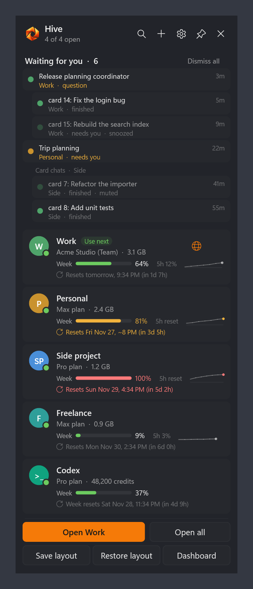
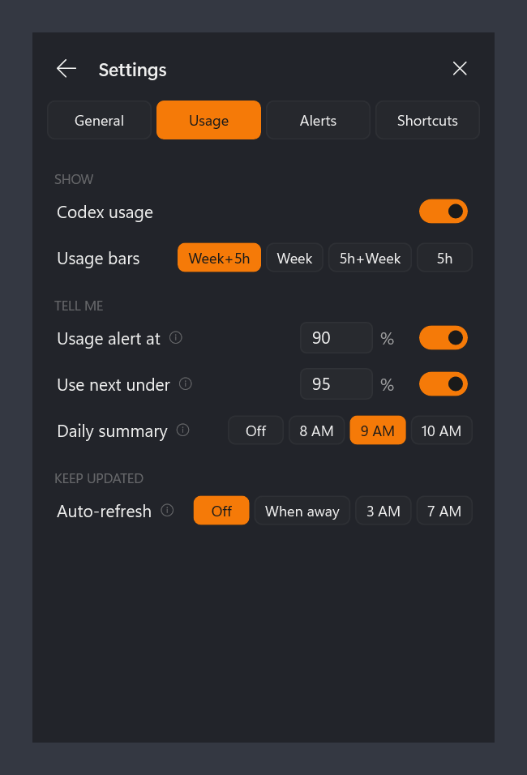
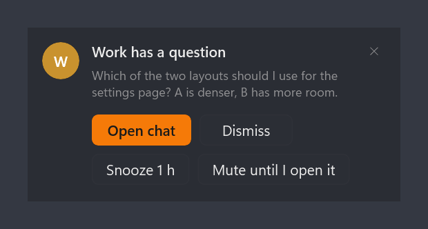
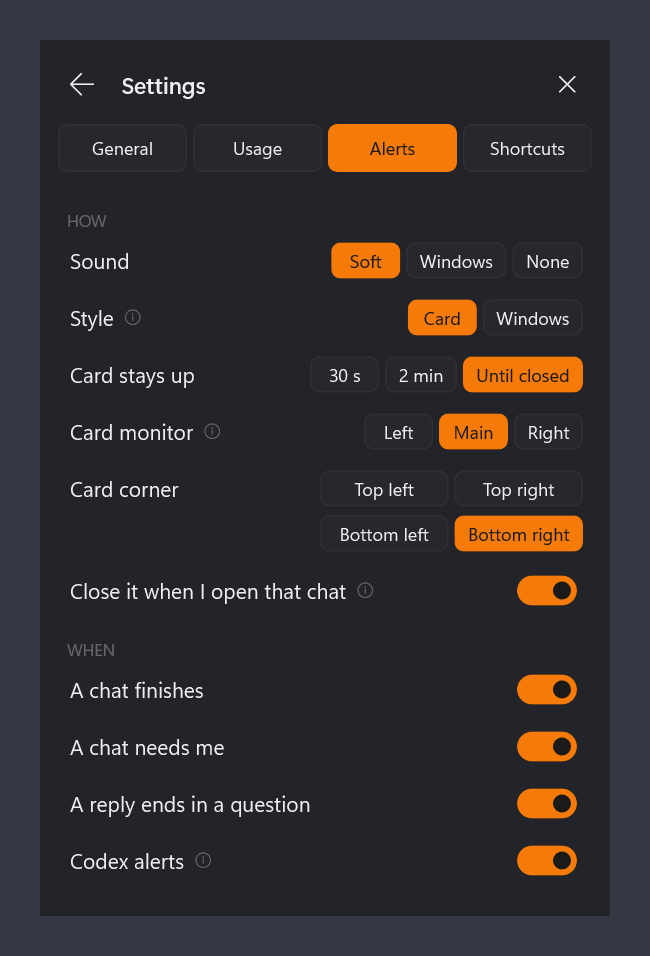
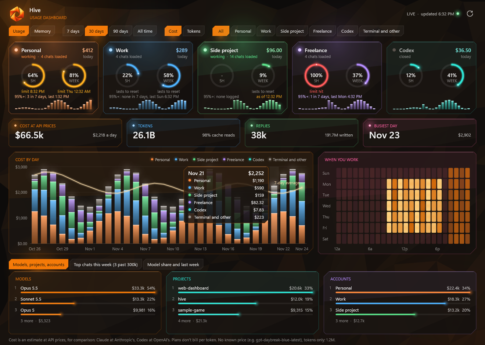

# Hive: Multi-Account Launcher and Manager for Claude and Codex

Hive runs several Claude Desktop and Claude Code accounts plus OpenAI Codex side by side on Windows, from one tray app. It shows each account's usage limits, switches between accounts in one click, and alerts you when a chat finishes or needs an answer.



## What it does

- **Run accounts side by side.** Each Claude Desktop account gets its own profile folder and its own window. Open one, open all, or let Hive start the ones you pick when Windows starts.
- **See usage limits.** Every row shows the 5-hour and weekly bars, the reset time, a 7-day trend line and how much memory the window uses.
- **Use next.** Hive tags the account whose week resets soonest while it still has room, so hours that would expire unused get spent first.
- **Chat alerts.** A card appears when a Claude Code chat finishes, asks a question or needs a permission. Click it to open that chat in the right account's window.
- **Waiting list.** The flyout lists every chat waiting on you, across all accounts.
- **Chat search.** Start typing in the flyout to search Claude Code chat titles in every account.
- **Dashboard.** Cost, tokens, models, projects and busy hours per account, plus the chats with the most tokens this week.

## Codex

Hive reads Codex's own session logs under `~/.codex/sessions`, so Codex sits in the same list as your Claude accounts.

- The Codex row shows your plan, credits, weekly usage and exact reset time. Click it to open the Codex app.
- Codex turns that finish or need you raise the same alert cards as Claude chats.
- Codex tokens appear in the dashboard next to Claude's, with an estimated cost at OpenAI's API prices. A model with no published price counts in tokens only.
- Settings > Usage can hide the Codex row, and Settings > Alerts can turn Codex alerts off.



## Alert cards

When a chat finishes or needs you, a card waits in the corner you choose, on the monitor you choose. Open jumps to the chat. You can also dismiss, snooze for an hour or mute that chat until you open it.





## Dashboard



All numbers in the screenshots are sample data from `Hive.exe --demo`. The window is the real app drawing made-up accounts.

## Install

Hive needs Windows 11 with the Claude Desktop app from the Microsoft Store, and a Rust toolchain to build it.

```powershell
git clone https://github.com/finalpantasy/hive-multi-account-launcher-manager
cd hive-multi-account-launcher-manager
cargo build --release
```

The program is `target\release\Hive.exe`. Copy it to any folder you like and run it there. Hive keeps its settings (`hive.json`), log and caches next to the exe.

## First run

1. Start `Hive.exe`. A tray icon appears. Click it, or press Ctrl+Alt+Shift+C, to open the flyout.
2. Click **+** to add an account: a name, the email you sign in with and an optional note. The first account can use the normal Claude Desktop profile. Every other account gets its own folder under `%USERPROFILE%\ClaudeProfiles`.
3. Open the account and sign in. Choose **Continue with email** and type the emailed code.
4. For chat alerts, run `Hive.exe --hook-entry`. It prints two Claude Code hook entries to paste into your Claude `settings.json`. All accounts share that file.
5. For Codex alerts, add `notify = ["<path to Hive.exe>", "--event", "codex"]` to `~/.codex/config.toml`. `Hive.exe --doctor` checks the setup and `--doctor --fix-codex` fixes the Codex line.

Settings > General has a switch to start Hive with Windows.

## More features

- Name tags on each window in the account's color, so you know which account you are in.
- Separate taskbar buttons for each account.
- Save and restore window layouts across monitors.
- Continue a chat in another account when one runs out of usage.
- Optional alert when an account passes a usage percent you pick, and a daily summary.
- A limit log (`limits.jsonl`) of each time an account passes 80, 95 and 100 percent.
- Context alarm: a card when a chat passes 250k and 300k tokens.
- Optional notes vault, worker inbox and job queue for people who run many Claude Code chats. Their folders default to `hive-control` next to the exe. Set `HIVE_MEMORY_DIR`, `HIVE_INBOX_DIR` or `HIVE_QUEUE_DIR` to move them, and `HIVE_PROJECT_ROOTS` (folders separated by `;`) to tell the notes vault where your projects live.

## How it works

- The first account uses the normal Store app profile. Every other account starts the Store package's `Claude.exe` with `--user-data-dir` pointing at its own folder.
- Open or closed comes from the profile's `lockfile`. The org name comes from the profile's own log.
- Usage comes from the `plan-usage-history.json` file Claude Desktop already writes, and from Codex's session logs.
- Alerts come from Claude Code hooks that run `Hive.exe --event`. The command appends one line to `hive-events.jsonl` and exits. The tray watches that file for changes, so nothing polls.
- The flyout draws with Direct2D on the CPU and frees its drawing resources when it closes.

## What Hive never touches

- It does not read Claude's sign-in data, cookies or tokens.
- It makes no network calls at all, so it never contacts claude.ai or any Anthropic or OpenAI server. Everything comes from files already on your disk.
- It does not store passwords.
- It removes `CLAUDE*` and `ANTHROPIC*` environment variables before it starts a window, so one account's settings cannot leak into another.
- Chat transcripts are read in place, only to find the last question, the context size and token counts. Nothing is copied off the machine.

## FAQ

**Does it work on macOS or Linux?** No. Hive uses Windows tray, window and Store-package APIs.

**Is it allowed to run several accounts?** Hive starts the normal Claude Desktop app with a separate profile folder per account and never signs in for you. Check Anthropic's current terms for how many accounts you may use.

**Why do two accounts show the same limits?** They are signed in to the same login and org, so they share one set of limits. Settings > Check setup flags this.

**Where is my data?** Next to the exe: `hive.json`, `hive.log`, `hive-events.jsonl` and a few small caches. Delete the folder to remove everything except the Claude profiles.

**How do I undo it?** Exit the tray, delete the Hive value under `HKCU\Software\Microsoft\Windows\CurrentVersion\Run` if you turned on start with Windows, and delete the exe folder.

**Can I make my own screenshots?** Run `Hive.exe --demo` for sample accounts, or `Hive.exe --render <folder>` to draw the screens off screen.

## License

Hive is free to use, change and share for any noncommercial purpose. Selling it or using it commercially is not allowed. The full text is the PolyForm Noncommercial License 1.0.0 in [LICENSE](LICENSE).
